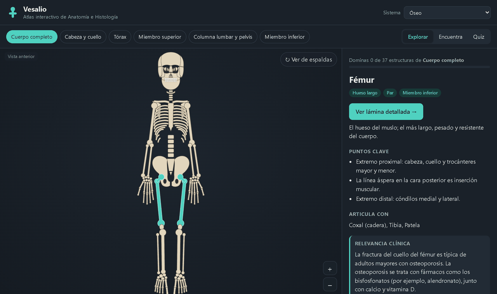
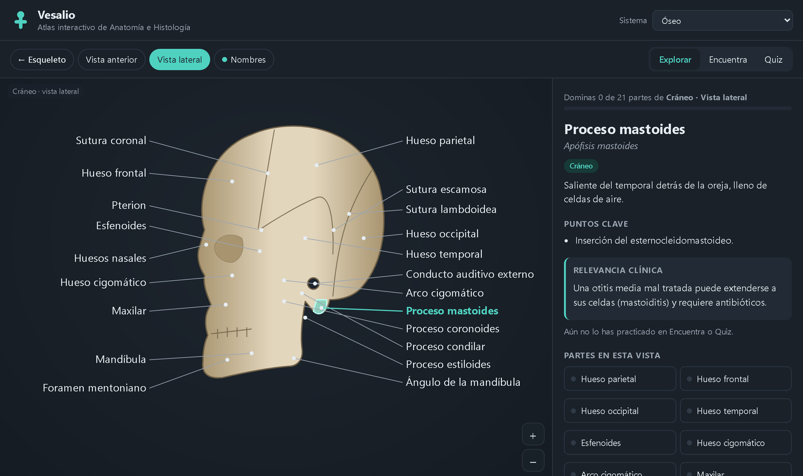
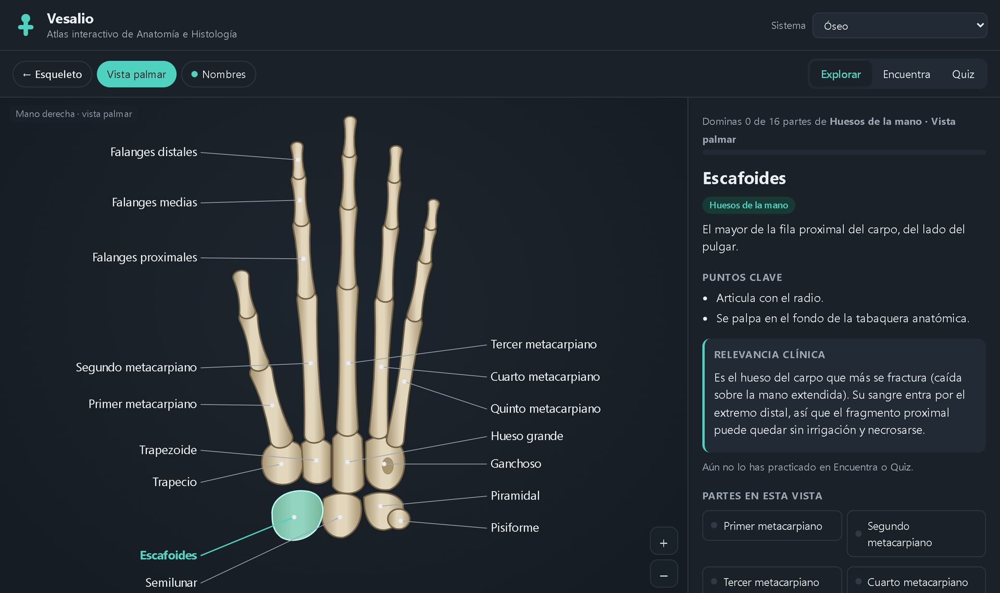
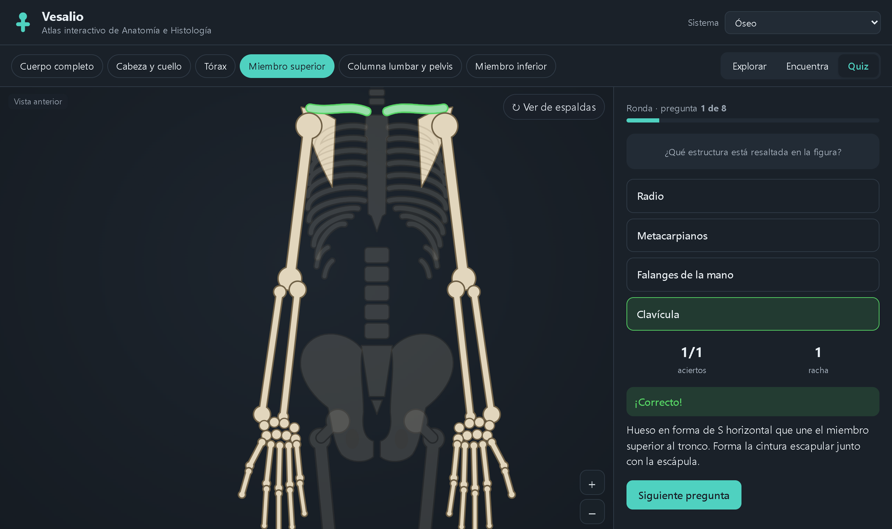
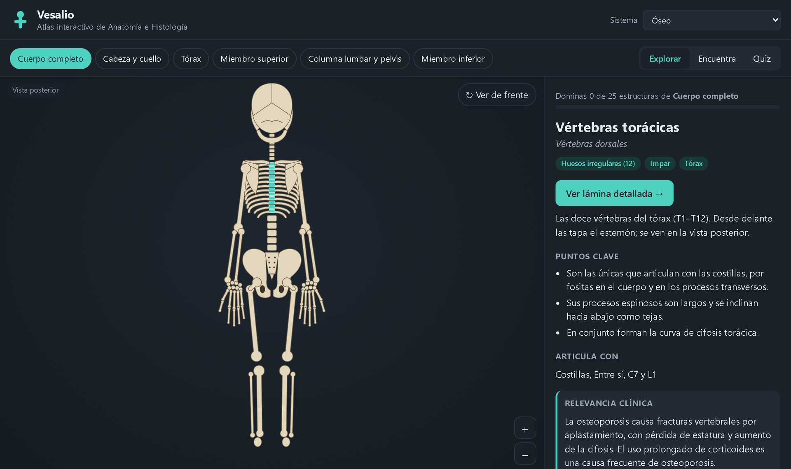
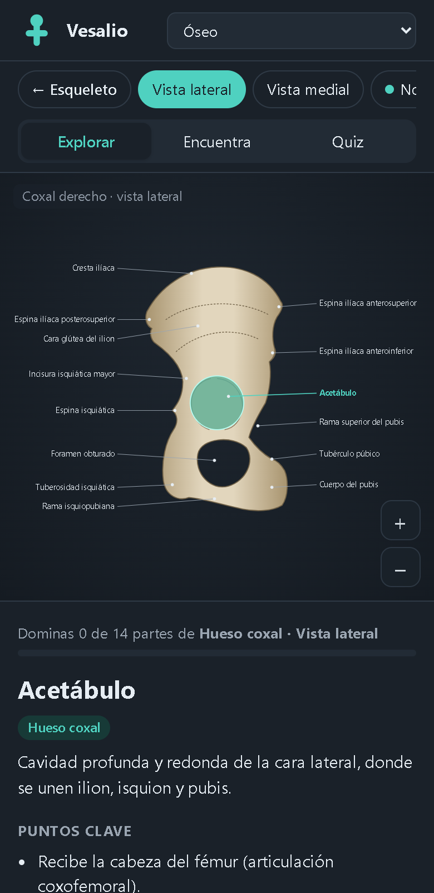

# Vesalio

**Atlas interactivo de anatomía para estudiantes de carreras de la salud.** Explora el esqueleto, abre láminas detalladas de cada hueso y ponte a prueba con un quiz que repite lo que fallas.

### 👉 [Probar Vesalio](https://danielperezrj.github.io/vesalio/)

Funciona en computador y celular, se puede **instalar como app** y se usa **sin conexión**.



---

## Por qué existe

Vesalio nació para ayudar a una estudiante de **Química y Farmacia** con el ramo de Anatomía e Histología. Los atlas comerciales son caros, están en inglés o pensados para Medicina, y no relacionan la anatomía con lo que necesita un futuro químico farmacéutico.

Por eso Vesalio:

- está en **español** y usa la **Terminología Anatómica** con la que se evalúa (fíbula, ulna, patela…), con el nombre clásico como alternativo;
- trae **relevancia clínica y farmacológica** en las fichas: vía intraósea, punción lumbar y anestesia epidural, inyecciones intramusculares, absorción de colirios, fármacos para la osteoporosis…;
- se adapta al estudio real, con un **quiz por rondas y repetición espaciada**, y sirve **sin internet**.

El nombre homenajea a Andrés Vesalio (1514–1564), considerado el padre de la anatomía moderna.

## Qué incluye

| | |
|---|---|
| **39** estructuras del esqueleto | vista anterior y posterior, en 6 regiones |
| **19** láminas detalladas | todos los huesos, con **32** vistas |
| **236** partes y accidentes óseos | cada una con ficha, puntos clave y pista |
| **103** notas de relevancia clínica | enfocadas en Farmacia |

**Tres modos de estudio**

- **Explorar:** toca un hueso o una parte y lee su ficha.
- **Encuentra:** la app te da un nombre y tú lo tocas en la figura.
- **Quiz:** rondas de 10 preguntas (qué está resaltado, o adivinar por una pista), con resumen al final.

**Además:** zoom con dos dedos, rueda o botones; rótulos que se ocultan para practicar; progreso guardado en el navegador; modo claro y oscuro automático.

## Capturas

| Lámina del cráneo | Lámina de la mano |
|---|---|
|  |  |
| **Quiz por rondas** | **Vista posterior** |
|  |  |

<p align="center"></p>

## Decisiones técnicas

- **Sin frameworks ni dependencias.** HTML, CSS y JavaScript puro (unas 4500 líneas). Se publica tal cual en GitHub Pages, sin paso de compilación.
- **Ilustraciones propias en SVG.** Todos los huesos están dibujados a mano con coordenadas, así que no hay problemas de licencia de imágenes y todo escala sin perder calidad.
- **El contenido son datos, no código.** Cada lámina es un objeto declarativo con partes, contornos, vistas y zonas clicables. El motor dibuja la figura, ubica los rótulos y arma los tres modos. Agregar un hueso nuevo no toca la lógica.
- **Vistas en espejo.** La vista posterior de un hueso reutiliza las coordenadas de la anterior reflejadas; los rótulos se recalculan para no salir invertidos.
- **Repetición espaciada con sistema de cajas (Leitner).** Fallar devuelve una estructura a la caja 0, que siempre vuelve en la ronda siguiente. Acertar la sube de caja, y vuelve tras 2, 3, 5 u 8 rondas.
- **PWA sin conexión.** Un service worker con estrategia *primero la red*: con internet siempre carga la última versión y la guarda; sin internet usa la copia. Así nunca se queda pegada una versión vieja.
- **Pensado para el celular.** El visor queda fijo arriba mientras se lee la ficha, admite pellizco para el zoom y la lista se adapta a pantallas angostas.

## Estructura del proyecto

```
index.html               página principal
manifest.webmanifest     datos para instalarla como app
sw.js                    service worker (uso sin conexión)
css/estilos.css          estilos: tema claro y oscuro, diseño adaptable
js/app.js                motor: dibujo, modos de estudio, zoom, progreso
js/sistemas/oseo.js      esqueleto completo: regiones, fichas y dibujo
js/laminas/*.js          una lámina detallada por hueso o grupo de huesos
iconos/                  íconos de la app
docs/capturas/           imágenes de este README
servidor.js              servidor local para desarrollo
```

## Ejecutarlo localmente

```bash
node servidor.js
```

Luego abre http://localhost:5173. También funciona desde el celular en la misma red Wi‑Fi, usando la IP del computador.

## Extenderlo

**Nueva lámina:** crea `js/laminas/<hueso>.js` siguiendo `humero.js`, con `partes` (fichas), `contorno` y `vistas` (dibujo y zonas clicables con `ancla` y `ly` para los rótulos). La clave debe coincidir con el `id` del hueso en `oseo.js`. Agrega su `<script>` en `index.html` antes de `app.js`, súmala a la lista `ARCHIVOS` de `sw.js` y sube su `VERSION`.

**Nuevo sistema:** crea `js/sistemas/<sistema>.js` con la misma forma que `oseo.js` (`regiones`, `estructuras`, `formas`) y regístralo en `window.SISTEMAS`.

## Próximos pasos

- [ ] Pruebas automáticas e integración continua con GitHub Actions
- [ ] Auditoría de accesibilidad y rendimiento con Lighthouse
- [ ] Sistema muscular y sistema circulatorio
- [ ] Sección de histología

## Aviso

Vesalio es una herramienta de estudio de apoyo: las ilustraciones son esquemáticas y no reemplazan a los textos de referencia ni a la docencia.

---

Hecho por [DanielPerezRJ](https://github.com/DanielPerezRJ).
